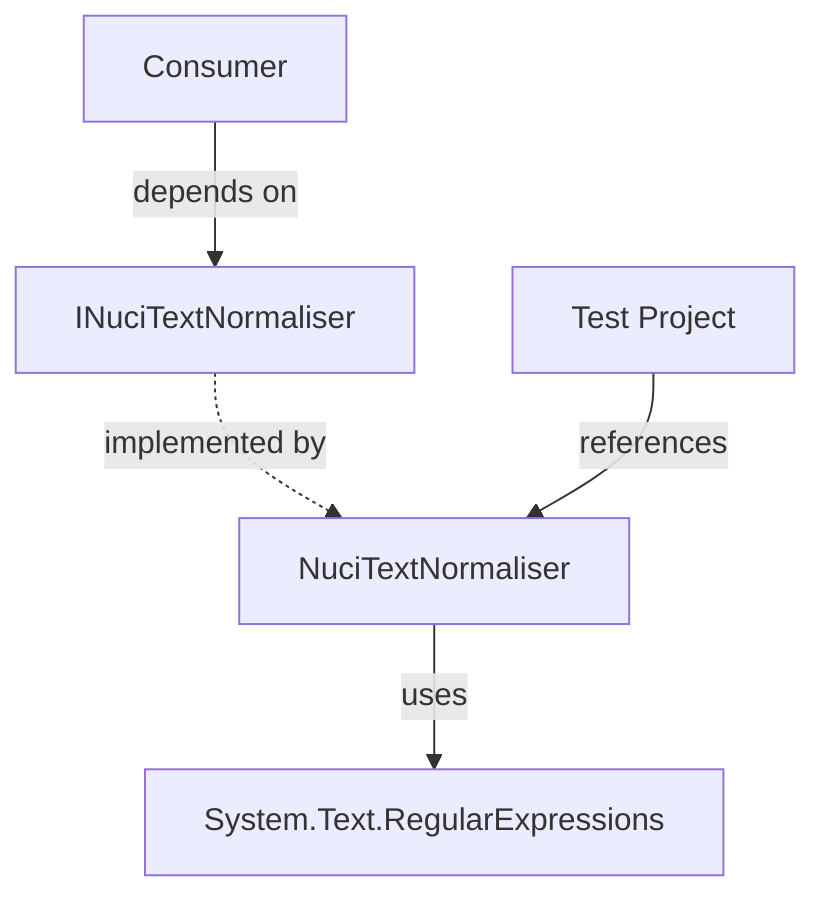

# NuciText.Normalisation Architecture

This document describes the current architecture of the `NuciText.Normalisation` library as implemented in this repository. It covers the system boundary, component relationships, runtime flow, and architectural constraints.

## Table of Contents

- [Purpose](#purpose)
- [System Context](#system-context)
- [Architectural Style](#architectural-style)
- [Runtime Flow](#runtime-flow)
- [Components](#components)
- [Data Architecture](#data-architecture)
- [Interfaces and Integrations](#interfaces-and-integrations)
- [Cross-Cutting Concerns](#cross-cutting-concerns)
- [Dependency Direction and Rules](#dependency-direction-and-rules)
- [External Dependencies](#external-dependencies)
- [Deployment and Operations](#deployment-and-operations)
- [Compatibility Contracts](#compatibility-contracts)
- [Testing and Verification](#testing-and-verification)
- [Design Constraints](#design-constraints)
- [Extension Points](#extension-points)
- [Architecture Decisions](#architecture-decisions)
- [Source Map](#source-map)
- [Related Documentation](#related-documentation)

## Purpose

`NuciText.Normalisation` is a small, dependency-free .NET library that provides text normalisation for single-sentence input. It exposes a single interface, `INuciTextNormaliser`, with one method, `NormaliseSentence`, which trims whitespace, collapses repeated spaces, fixes spacing around punctuation, capitalises sentence starts, and appends a terminal period when one is missing. The library targets .NET 10 and is distributed as a NuGet package under the GPL-3.0-or-later license.

This architecture document is intended for maintainers and consumers who need to understand the library's internal structure, extension boundaries, and operational characteristics.

## System Context


The principal external boundaries are:
- **Consumer Application:** Initiates normalisation by calling `NormaliseSentence(string)`. Owns the input string and receives the normalised output. No callbacks or events.
- **System.Text.RegularExpressions (BCL):** Provides `Regex.Replace` and `Regex.IsMatch` for stages 4–7 of the pipeline. Owned by the .NET runtime; the library has no version pin beyond the target framework.

## Architectural Style

The library follows a **single-responsibility, stateless functional core** style with an **interface-based contract**:

- **Single-responsibility library** — one interface, one implementation, one public method
- **Stateless functional core** — no instance state, no side effects, inherently thread-safe
- **Interface-based contract** — enables mocking, substitution, DI registration
- **Sealed implementation** — prevents inheritance, guarantees behaviour
- **Zero external dependencies** — only BCL (`System.Text.RegularExpressions`), no NuGet dependencies in the library project

```mermaid
flowchart TD
    subgraph Library[NuciText.Normalisation]
        Interface[INuciTextNormaliser\n(interface)]
        Implementation[NuciTextNormaliser\n(sealed class)]
    end

    Consumer[Consumer] -->|depends on| Interface
    Implementation -.->|implements| Interface
    Implementation -->|uses| BCL[System.Text.RegularExpressions]
```

The principal architecture boundaries are:
- **Public Contract (`INuciTextNormaliser`):** Defines the single method `NormaliseSentence(string): string`. Zero dependencies. Stable surface for consumers.
- **Implementation (`NuciTextNormaliser`):** Contains the 7-stage deterministic pipeline. Depends only on `System.Text.RegularExpressions`. Sealed to prevent behavioural drift.

## Runtime Flow

```mermaid
flowchart TD
    Start([NormaliseSentence called]) --> Guard{string.IsNullOrWhiteSpace(input)?}
    Guard -->|Yes| ReturnNull[return null]
    Guard -->|No| Trim[result = input.Trim()]
    Trim --> Collapse[while result.Contains("  "): result = result.Replace("  ", " ")]
    Collapse --> Regex4[result = Regex.Replace(result, @"\s+([.,!?;:])", "$1")]
    Regex4 --> Regex5[result = Regex.Replace(result, @"([,!?;:])([^\s\d])", "$1 $2")]
    Regex5 --> Regex6[result = Regex.Replace(result, @"(^\s*[a-z])|([.!?]\s+[a-z])", ToUpper)]
    Regex6 --> Terminal{Regex.IsMatch(result, @"[.!?]$")?}
    Terminal -->|No| Append[result += "."]
    Terminal -->|Yes| Return[return result]
    Append --> Return
    ReturnNull --> End([Return])
    Return --> End
```

The principal runtime sequence is:
1. **Null/whitespace guard** — fast exit returning `null` for invalid input
2. **Trim** — remove leading/trailing whitespace
3. **Collapse repeated spaces** — iterative `Replace` loop normalises internal whitespace to single spaces
4. **Remove spaces before punctuation** — regex removes whitespace preceding `.,!?;:`
5. **Ensure space after punctuation** — regex inserts space after `,!?;:` when followed by non-whitespace, non-digit
6. **Capitalise sentence starts** — regex upper-cases first letter of string and first letter after `.!?` + whitespace
7. **Append terminal period** — if result lacks `.`, `!`, or `?` at end, append `.`

## Components

| Component | Responsibility | Principal Dependencies | Lifetime or Ownership |
|-----------|----------------|------------------------|-----------------------|
| `INuciTextNormaliser` | Public contract; single method `NormaliseSentence(string): string` | None | Owned by library; stable across versions |
| `NuciTextNormaliser` | Sealed implementation of the 7-stage normalisation pipeline | `System.Text.RegularExpressions` (BCL) | Owned by library; instantiated per-consumer or as singleton |

## Data Architecture

```mermaid
flowchart LR
    Input[Input string\n(UTF-16, caller-owned)] --> Pipeline[7-stage pipeline\n(pure transformations)]
    Pipeline --> Output[Output string\n(UTF-16, caller-owned)]
```

| Data or Store | Owner | Representation and Storage | Lifecycle or Consistency |
|---------------|-------|----------------------------|--------------------------|
| Input string | Caller | .NET `string` (UTF-16, immutable) | Caller-owned; not modified by library |
| Intermediate results | `NormaliseSentence` method | .NET `string` allocations (5–15 per call) | Short-lived; eligible for Gen 0 GC |
| Output string | Caller | .NET `string` (UTF-16, immutable) | Caller-owned; returned from method |

The library does not persist, cache, or transmit data. All transformations are in-memory, pure, and deterministic.

## Interfaces and Integrations

| Interface or Integration | Direction | Contract | Owner | Failure Semantics |
|--------------------------|-----------|----------|-------|-------------------|
| `INuciTextNormaliser.NormaliseSentence` | Inbound | `string NormaliseSentence(string input)` | Library | Returns `null` for null/whitespace; never throws |

No outbound integrations, remote providers, devices, or external systems exist.

## Cross-Cutting Concerns

### Security and Privacy

- **Trust boundary:** Library runs entirely within the consumer's process. No elevation, no sandbox.
- **Input validation:** Null/whitespace guard returns `null`; no length limit enforced (caller responsibility).
- **Secrets:** None processed, logged, or stored.
- **Sensitive data:** Input may contain PII — library does not inspect, log, or sanitise beyond normalisation. Consumer must comply with applicable regulations.
- **ReDoS:** All regex patterns are constants; no user input in patterns; no catastrophic backtracking possible.

### Error Handling

- **No exceptions thrown** for any string input (including `null`).
- **Null input** → `null` output (documented contract).
- **Invalid regex** — impossible (patterns are compile-time constants).
- **Allocation failure** — propagates `OutOfMemoryException` (unrecoverable, not handled).

### Observability

- **No logging, metrics, traces, or health checks** built in.
- **Consumer can wrap** for observability (see Extension Points).

### Configuration

- **No configuration** — no files, environment variables, command-line arguments, or services.
- **Behaviour is fixed** by implementation; changes require code modification and version bump.

### Concurrency and Resource Use

- **Stateless** — no shared state, no locks, no synchronization primitives.
- **Thread-safe** — multiple threads can call `NormaliseSentence` concurrently on the same instance.
- **Allocations per call:** ~5–15 short-lived strings (Gen 0).
- **No unmanaged resources** — no `IDisposable`, no handles, no finalizers.
- **Capacity:** Limited by caller's memory and GC throughput; no internal bounds.

## Dependency Direction and Rules



The principal dependency rules are:
- **Consumers depend on abstraction** — `INuciTextNormaliser`, not `NuciTextNormaliser`
- **Implementation depends on BCL only** — no third-party packages
- **Tests depend on implementation** — project reference to library
- **No circular dependencies** — single-direction acyclic graph
- **No internal dependencies** — single implementation class

## External Dependencies

| Dependency | Responsibility | Integration Boundary | Architectural Consequence |
|------------|----------------|----------------------|---------------------------|
| `System.Text.RegularExpressions` | Regex engine for stages 4–7 | Direct static calls (`Regex.Replace`, `Regex.IsMatch`) | Coupled to .NET BCL behaviour; target framework `net10.0` pins minimum runtime |

Test dependencies (not in NuGet package):
- `NUnit` 4.5.0 — test framework
- `Moq` 4.20.72 — mocking for interface tests
- `Microsoft.NET.Test.Sdk` 18.3.0 — test host

## Deployment and Operations

| Concern | Current Design | Architectural Consequence |
|---------|----------------|---------------------------|
| **Process topology** | In-process library | No separate service, no IPC, no network |
| **Deployment unit** | NuGet package (`NuciText.Normalisation.nupkg`) | Standard .NET package consumption |
| **Persistent state** | None | No migrations, no backup, no recovery |
| **Filesystem** | None | No file access, no permissions needed |
| **Network** | None | No firewall rules, no endpoints |
| **Scaling** | Stateless, per-call allocations | Horizontal scaling via consumer concurrency |
| **Startup** | Zero (no initialization) | Instant first call |
| **Shutdown** | Zero (no cleanup) | No graceful shutdown needed |

## Compatibility Contracts

| Contract | Owner | Invariant | Verification | Change Policy |
|----------|-------|-----------|--------------|---------------|
| `INuciTextNormaliser.NormaliseSentence` | Library | Signature, null/whitespace → null, deterministic pipeline | Unit tests (NUnit) | Breaking change requires major version bump |
| Normalisation output format | Library | 7-stage pipeline behaviour as documented | Unit tests with `TestCase` parameters | Behaviour change = major version |
| NuGet package ID | Library | `NuciText.Normalisation` | Pack output | Stable |
| Target framework | Library | `net10.0` | csproj | Change requires recompilation |

## Testing and Verification

Test project: `NuciText.Normalisation.UnitTests` (NUnit 4.5.0)

Architecture boundaries verified:
- **Contract tests:** Null/whitespace returns null
- **Behaviour tests:** 7 `TestCase` parameters covering full pipeline
- **Mock tests:** Interface can be mocked (Moq)

Execute the principal automated verification with:

```bash
dotnet test --no-build --verbosity normal
```

Material coverage gaps:
- No fuzzing or property-based tests
- No performance benchmarks
- No security scanning in CI

## Design Constraints

- **Single method interface:** Cannot add methods without breaking consumers
- **Sealed implementation:** Cannot be extended via inheritance
- **No configuration:** Behaviour is fixed; customisation requires fork or wrapper
- **No localisation:** Capitalisation uses invariant culture `ToUpper()`; no culture parameter
- **No async:** Synchronous only; no `Task` or `ValueTask` return
- **No streaming:** Entire input must be in memory as `string`
- **GPL-3.0-or-later:** Copyleft license; consumers must comply

## Extension Points

### Consumer-side wrapping (Decorator pattern)

1. Implement `INuciTextNormaliser` wrapping an inner instance
2. Register wrapper in DI container instead of concrete type
3. Add verification (tests) for wrapper behaviour

```csharp
public class LoggingNormaliser : INuciTextNormaliser
{
    private readonly INuciTextNormaliser _inner;
    private readonly ILogger _logger;

    public LoggingNormaliser(INuciTextNormaliser inner, ILogger logger)
    {
        _inner = inner;
        _logger = logger;
    }

    public string NormaliseSentence(string input)
    {
        _logger.LogDebug("Normalising: {Input}", input);
        var result = _inner.NormaliseSentence(input);
        _logger.LogDebug("Result: {Result}", result);
        return result;
    }
}
```

Conventions:
- Wrapper must implement `INuciTextNormaliser`
- Wrapper must delegate to inner instance for core behaviour
- Wrapper must preserve null/whitespace contract

## Architecture Decisions

| Decision | Rationale | Consequence | Record |
|----------|-----------|-------------|--------|
| Interface + sealed implementation | Enables DI, mocking, substitution; prevents inheritance drift | Consumers depend on abstraction; implementation can change internally | Documented here |
| Stateless, no side effects | Thread-safe by default; simple reasoning; no resource management | No caching, no configuration, no observability built in | Documented here |
| 7-stage deterministic pipeline | Predictable, testable, documented behaviour | Fixed behaviour; changes require version bump | Documented here |
| Iterative space collapse (not regex) | Simpler, no regex overhead for this stage | O(n²) worst case for pathological input | Documented here |
| Constant regex patterns | No ReDoS risk; no user input in patterns | Patterns cannot be customised | Documented here |
| GPL-3.0-or-later license | Copyleft; ensures derivative works remain free | Commercial consumers must evaluate compatibility | LICENSE file |
| Target net10.0 only | Modern .NET; no multi-targeting complexity | Requires .NET 10 runtime; no netstandard/net8.0 | csproj |

## Source Map

| Area | Path |
|------|------|
| Library (interface + implementation) | `NuciText.Normalisation/` |
| Unit tests | `NuciText.Normalisation.UnitTests/` |
| CI workflow | `.github/workflows/dotnet.yml` |
| Solution file | `NuciText.Normalisation.sln` |
| Documentation | `docs/` |

## Related Documentation

- [README.md](../README.md) — installation, usage, and badge links
- [LICENSE](../LICENSE) — GPL-3.0-or-later license text
- [docs/INDEX.md](./docs/INDEX.md) — documentation catalogue and navigation
- [docs/architecture.md](./docs/architecture.md) — detailed architecture (this file mirrored in docs)
- [docs/components/nuci-text-normaliser.md](./docs/components/nuci-text-normaliser.md) — implementation deep dive
- [docs/flows/normalise-sentence.md](./docs/flows/normalise-sentence.md) — pipeline execution flow
- [docs/api-reference/INDEX.md](./docs/api-reference/INDEX.md) — API reference
- [docs/testing.md](./docs/testing.md) — test strategy and organisation
- [docs/build-and-deployment.md](./docs/build-and-deployment.md) — build pipeline and CI
- [docs/security.md](./docs/security.md) — threat model and hardening
- [docs/state-and-persistence.md](./docs/state-and-persistence.md) — memory and lifecycle
- [docs/integrations.md](./docs/integrations.md) — integration patterns